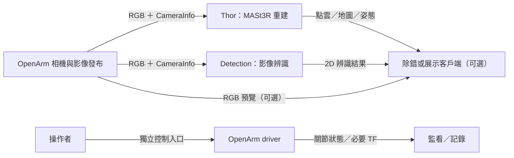
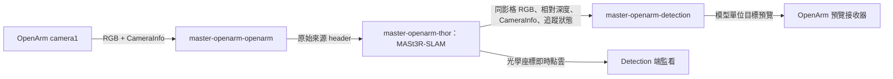

# 系統架構

**第一版目標：**一套 OpenArm 相機來源，同時提供 Thor 重建和 Detection 辨識；相機預覽、地圖和辨識結果可各自查看。此階段先把感知鏈跑通，手臂動作仍由操作者在 OpenArm 端掌控。

| 能力 | 資料所有者 | 說明 |
|---|---|---|
| RGB、時間戳、內參 | OpenArm 相機端 | 一處採集，供兩端獨立訂閱；保留來源 `stamp` 和 optical frame |
| 重建、地圖、姿態 | Thor | 以實際 MASt3R runtime 能力為準；先說明地圖座標、比例與重啟行為 |
| 影像識別 | Detection | 結果對應原始 RGB 影格；辨識失效不影響相機或重建繼續運行 |
| 手臂狀態／運動 | OpenArm driver | 影像不控制機械臂；模擬與真機必須明確區別 |

| 執行端 | Codex 遠端專案 | 主機 | 工作目錄 |
|---|---|---|---|
| OpenArm | `炫智的openarm` | `hrclab` | `/home/hrclab/jeff/openarm_dev` |
| Thor | `Thor` | `thor` | `/home/hrc/mast3r_openvins` |
| Detection | `皓澤電腦` | `harold` | `/home/harold/Desktop/try` |

第一輪以 OpenArm 已有的 `camera1` 原始彩色影像為共同來源。Thor 和 Detection 透過 ROS 2 DDS 各自訂閱同一個發布者。兩端已以臨時訂閱器驗證收訊，應用程式整合與驗收見 [INTERFACE.md](INTERFACE.md)。展示客戶端可後接 Unity 或其他工具。

## 影像與故障隔離

- **共用來源、各自處理。** 若兩端需要不同解析度或壓縮，由各端在可追溯的輸入之後處理。resize／crop 後要維持像素座標與內參對應，不改寫來源 stamp。相機有 depth 也先核對是否真需要，再決定傳輸。
- **各自的速率與佇列。** Detection 若追即時性，可選最新影格；Thor 按其追蹤需求取樣。不得讓其中一個慢接收者拖住另一個或相機發布。實際丟幀／QoS 策略須在介面中核准。
- **可觀察性。** 至少能查到每路收訊速率、最後來源 stamp、解碼錯誤和各端健康狀態。相機斷流時結果標記過期；重連後辨識重新取新影格，地圖是否續接取決於 Thor 的 session 語義。
- **座標邊界。** 2D 結果只有像素座標。若以後要做 3D 定位，需有經核對的尺度、RGB／深度配準、對應影格及 optical → OpenArm base 的標定。不能將估計的 MASt3R 尺度直接當手臂公尺座標。

## 第一輪驗收

| 順序 | 驗收內容 | 通過條件 |
|---|---|---|
| 1. 唯讀盤點 | 核對三端工作區、來源與消費者 | **PASS**。三端已以相同來源 stamp 與原始資料雜湊核對 `camera1` 的即時收訊 |
| 2. 錄影重播 | 隔離環境重播同一份 RGB 與 CameraInfo | 兩端應用程式可解碼影像，並以原始來源 stamp 核對輸出 |
| 3. 靜止相機 | OpenArm 影像 → Thor 與 Detection 同時處理 | Thor 有新點雲，Detection 結果可對回原始影格；能觀察斷流、延遲和恢復 |
| 4. 控制另驗 | 如要接手臂動作，先模擬驗收 | 需另有已確認的控制介面、所有權、安全停止與操作者授權；不屬於前 3 步 |

## MASt3R-SLAM 即時 RGB-D 與目標預覽

Thor 以 MASt3R-SLAM 的追蹤影格產生對齊原圖的深度。點雲供監看，Detection 直接使用對齊深度和 `CameraInfo`，因此可在識別區域取有效深度並反投影成 optical frame 的目標點。單目估算尺度仍待校正，目標資料保留模型單位與來源 stamp。

本輪 profile 為離線／模擬及經授權的唯讀相機驗證。三個容器分開管理，OpenArm 容器僅負責影像轉送與目標預覽。後續若要把預覽轉為夾取，需有公尺尺度與 optical → base 驗證、夾爪姿態和接近路徑、工作空間及碰撞檢查、失效與停止處理，並由 OpenArm 端唯一控制入口在模擬驗收後取得操作者許可。

## AprilTag 公尺尺度與夾取規劃

Thor 的補充校正程序使用 25h9、ID 0、77.8 mm 的 AprilTag，輸出帶來源 stamp 的平面定尺結果。獨立同影格深度可為目標區像素提供公尺驗證。OpenArm 在驗證相機到基座的靜態外參後，於本地鎖定並確認一筆 Detection 公尺候選，請 MoveIt 規劃預抓取和無碰撞接近。隔離 mock 可接收模擬軌跡。目前狀態和各端部署入口見 [交接手冊](HANDOFF.md)。
